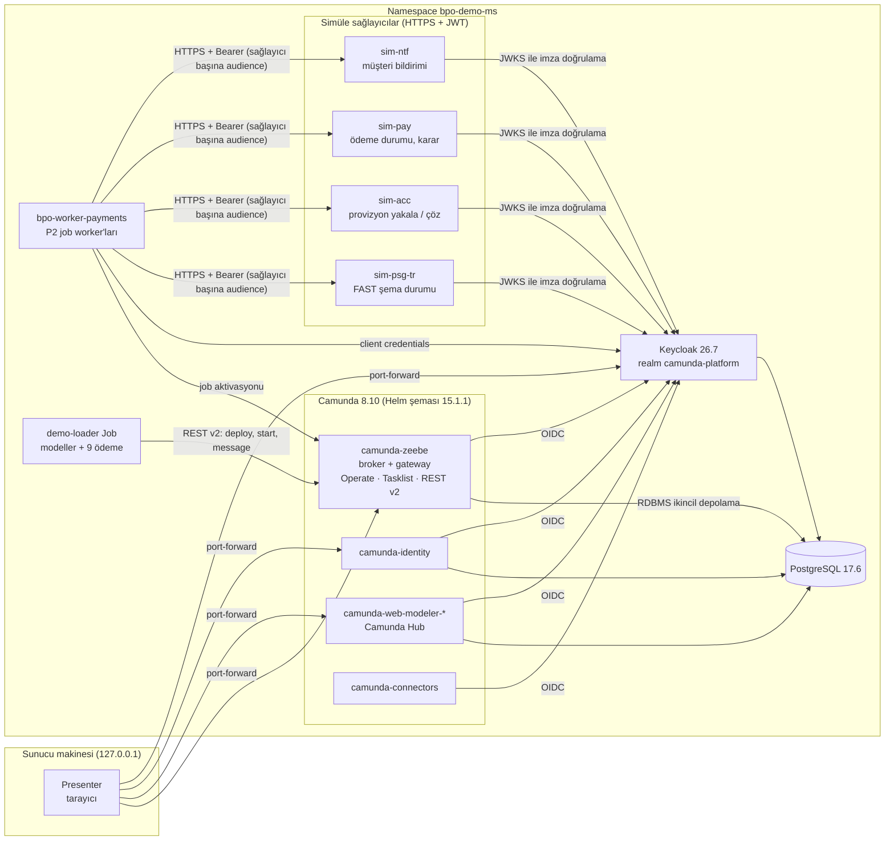
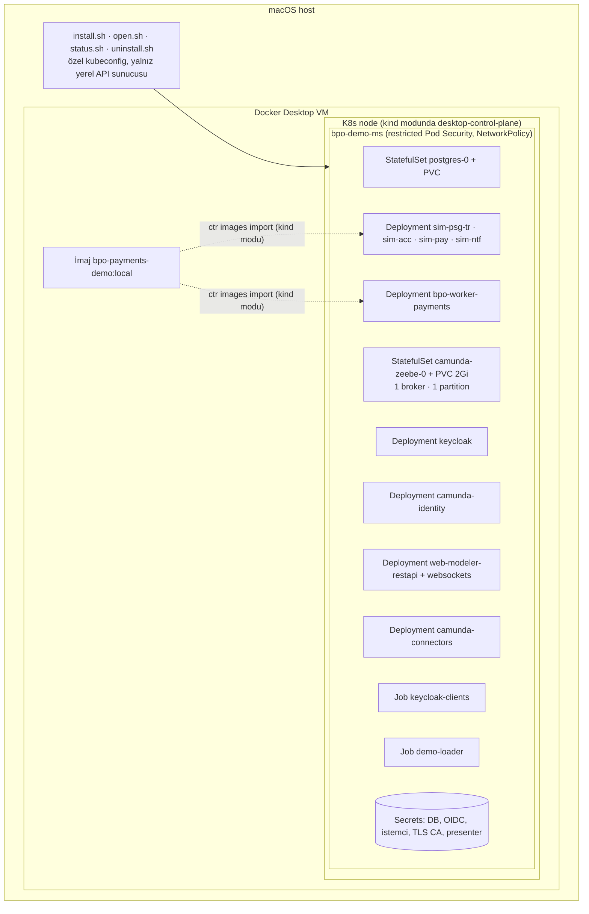
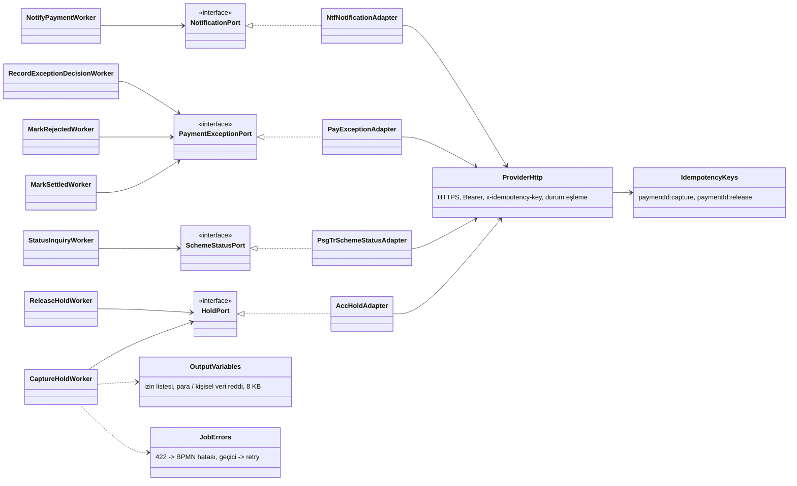
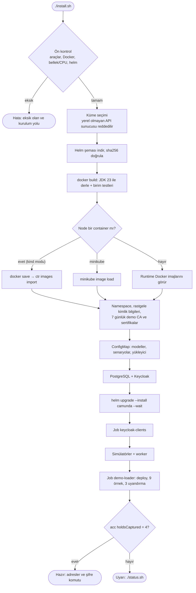
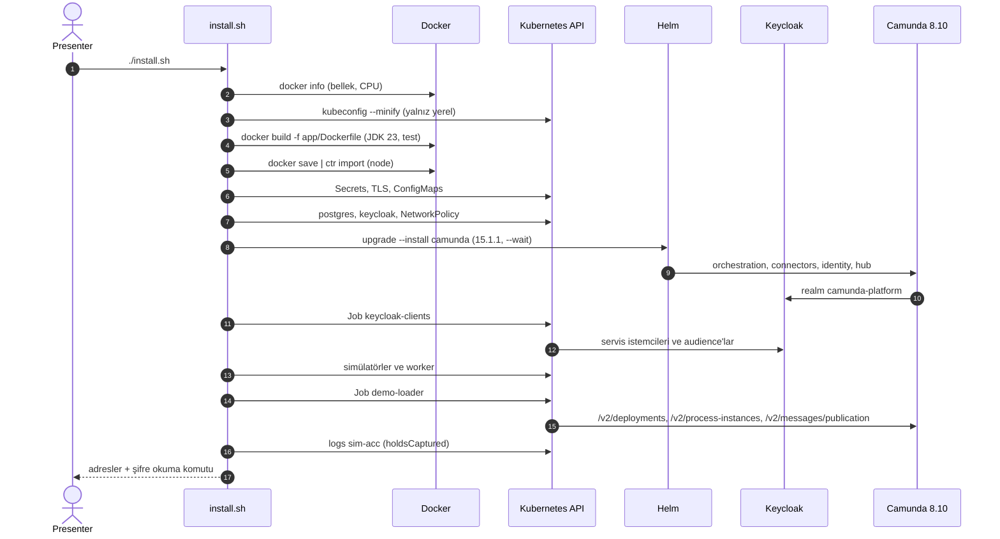
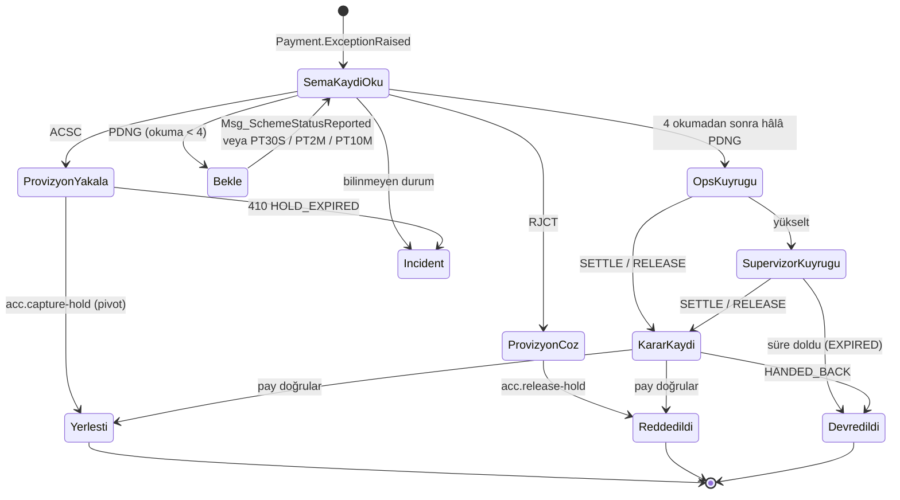
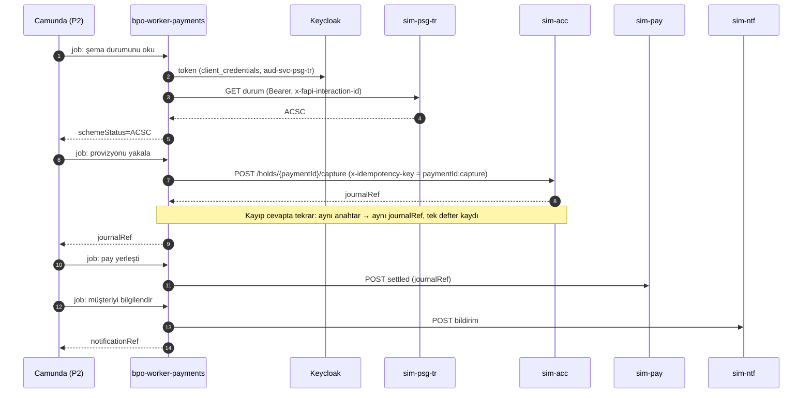
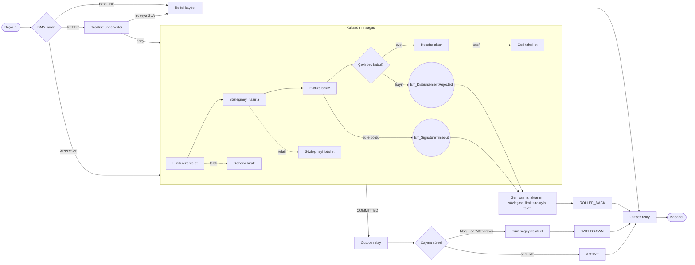
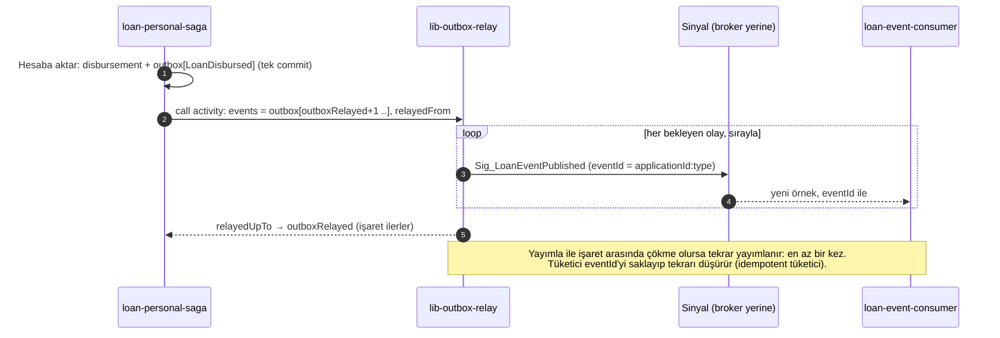

# demo-camunda-k8s

**Camunda 8.10** üzerinde **TR BKM FAST istisna süreci** (P2 `pay-instant-exception`) demosu. Yerel bir
Kubernetes kümesine (varsayılan: Docker Desktop) **tek komutla** kurulur. Her bileşen ayrı bir servis olarak
çalışır: Camunda 8.10 orkestrasyon kümesi, Connectors, Management Identity, Camunda Hub, Keycloak, PostgreSQL,
dört simüle sağlayıcı ve gerçek ödeme worker'ları.

```bash
./install.sh
```

Yerel ve geçici bir demodur; yalnızca **sentetik veri** kullanır. Hedef üretim topolojisi değildir (bkz. [Hedef topolojiden farklar](#hedef-topolojiden-farklar)).

---

## İçindekiler

1. [Hızlı başlangıç](#hızlı-başlangıç)
2. [Ön koşullar](#ön-koşullar)
3. [Mimari (UML)](#mimari-uml)
4. [Kurulum akışı](#kurulum-akışı)
5. [P2 süreci ve örnek veri](#p2-süreci-ve-örnek-veri)
6. [İhtiyaç kredisi: saga ve outbox](#i̇htiyaç-kredisi-saga-ve-outbox)
7. [Demo senaryosu](#demo-senaryosu)
8. [Test durumu](#test-durumu)
9. [Güvenlik modeli](#güvenlik-modeli)
10. [Komutlar ve ayarlar](#komutlar-ve-ayarlar)
11. [Sorun giderme](#sorun-giderme)
12. [Depo yapısı](#depo-yapısı)
13. [Hedef topolojiden farklar](#hedef-topolojiden-farklar)

---

## Hızlı başlangıç

```bash
git clone https://github.com/COPUR/demo-camunda-k8s.git
cd demo-camunda-k8s
./install.sh          # ilk kurulum uzun sürer (imajlar, Gradle, Helm şeması iner); süre makineye göre değişir
./open.sh             # ayrı bir terminalde açık bırakın; arayüzler yalnız 127.0.0.1'de
```

Giriş: kullanıcı adı **`presenter`**. Şifre kurulumda rastgele üretilir ve yalnızca bir Kubernetes Secret'ında
durur; `install.sh` sonunda okuma komutunu yazdırır.

| Arayüz | Adres | Ne gösterir |
|---|---|---|
| Operate | http://localhost:8080/operate | Süreç örnekleri, izlenen yol, değişkenler, bekleme durumları, olay kayıtları |
| Tasklist | http://localhost:8080/tasklist | `pay-tr-fast-ops` ve `pay-tr-fast-supervisor` kuyruklarındaki kararlar |
| Hub | http://localhost:8070 | BPMN, DMN ve form modelleri (8.10'da Web Modeler + Console = Hub) |
| Identity | http://localhost:8084 | Kullanıcılar, roller, istemciler |
| Keycloak | http://localhost:18080/auth | OIDC sağlayıcı (yönetici konsolu demo için gerekmez) |

Durum kontrolü: `./status.sh`. Her şeyi silmek için: `./uninstall.sh`.

---

## Ön koşullar

| Gereksinim | Neden | Kontrol |
|---|---|---|
| Docker Desktop, **Kubernetes açık** | Küme ve imaj derlemesi | `kubectl --context docker-desktop get nodes` → `Ready` |
| Docker belleği **≥ 8 GB** (12 GB önerilir), **6 CPU** önerilir | Camunda, Hub, Keycloak, PostgreSQL ve 5 Java servisi | `docker info --format '{{.MemTotal}} {{.NCPU}}'` |
| `kubectl`, `helm` 3.19+ veya 4.x, `openssl`, `curl` | Kurulum betikleri | macOS: `brew install kubectl helm openssl` |
| Boş disk ≈ 10 GB | Camunda imajları ve derleme önbelleği | `docker system df` |
| Windows'ta **WSL 2** (Ubuntu) | Betikler bash; Git Bash yol dönüştürmesi `docker run -v` bağlamalarını bozar | Docker Desktop > Settings > Resources > WSL integration açık; depoyu WSL içinde (`~/`) klonlayın |

**JDK veya Gradle gerekmez:** uygulama imajı Docker içinde JDK 23 ile derlenir ve test edilir; `keytool` da
çalışma zamanı imajının içinde koşar.

Kümede başka iş yükleri belleğin büyük kısmını istiyorsa pod'lar `Pending` kalabilir; `install.sh` bunu uyarı
olarak bildirir.

---

## Mimari (UML)

### Bileşen diyagramı



### Dağıtım diyagramı



### Sınıf diyagramı: worker'ın hexagonal yapısı



---

## Kurulum akışı

`install.sh` tek komuttur ve tekrar çalıştırılabilir: var olan Secret'lar korunur, geri kalan her şey yeniden
uygulanır.



### Kurulum dizisi



---

## P2 süreci ve örnek veri

`pay-instant-exception`, FAST'ten cevabı gelmeyen bir anlık ödemeyi devralır. Süreç talimatı **asla yeniden
göndermez**; yalnızca ağ geçidinin (`psg-tr`) kaydını okur.

### Durum makinesi



### ACSC yolu



### Örnek veri (`sample-data/scenarios.json`)

| Ödemeler | psg-tr cevabı | Sonuç |
|---|---|---|
| `demo-tr-acsc-001..003` | ACSC | provizyon tek kez yakalanır, pay yerleşti, müşteri bilgilenir |
| `demo-tr-rjct-001..002` | RJCT | provizyon çözülür, pay reddedildi, müşteri bilgilenir |
| `demo-tr-pdng-001` | önce PDNG, sonra ACSC | bekler, olay uyandırır, ikinci okuma yerleştirir |
| `demo-tr-unres-001..003` | her okumada PDNG | dört okuma, sonra TR FAST operasyon kuyruğunda görev |

Beklenen: **9 örnek; 4 yerleşti, 2 reddedildi, 3 Tasklist'te karar bekliyor.** Yükleyici
`Msg_SchemeStatusReported` mesajını üç kez yayımlar (olay köprüsünün yapacağı gibi); böylece demo gerçek
zamanlayıcıları beklemez.

**Camunda yalnızca süreç durumunu tutar:** kimlik, enum, zaman damgası. Tutar, IBAN, isim veya iş kuralı sürece
girmez; `OutputVariables` bunları çalışma anında reddeder.

---

## İhtiyaç kredisi: saga ve outbox

`loan-personal-saga`, bir ihtiyaç kredisinin kullandırımını **saga** olarak yürütür ve olaylarını
**transactional outbox** üzerinden yayımlar. Amaç Camunda 8.10'un bu iki deseni modelin kendisinde nasıl
taşıdığını göstermektir; P2'den bağımsızdır, ek worker ya da simülatör gerektirmez.

| Model | Ne gösterir |
|---|---|
| `loan-personal-saga.bpmn` | Saga: DMN kararı, insan onayı, üç yerel adım ve telafileri, imza bekleme, cayma süresi |
| `lib-outbox-relay.bpmn` | Outbox relay: henüz yayımlanmamış olayları sırayla yayımlar, sonra işareti ilerletir |
| `loan-event-consumer.bpmn` | Tüketici: yayımlanan her olay için bir örnek (bildirim veya muhasebe projeksiyonu yerine) |
| `loan-credit-decision.dmn` | Sentetik kredi politikası: skor, tutar ve taksit/gelir oranına göre APPROVE, REFER, DECLINE |
| `loan-underwriter-decision.form` | REFER edilen başvuru için Tasklist formu |

### Kullanılan Camunda özellikleri

| Desen ihtiyacı | Camunda 8.10 karşılığı | Modeldeki öğe |
|---|---|---|
| Adım başına geri alma | Telafi sınır olayı + `isForCompensation` işleyici | `Task_ReserveLimit` → `Task_ReleaseLimit`, `Task_DrawUpContract` → `Task_CancelContract`, `Task_Disburse` → `Task_CollectBack` |
| Hata olunca geri sarma | Hata bitiş olayı + hata ile başlayan olay alt süreci | `EndEvent_SignatureExpired`, `EndEvent_DisbursementRejected` → `SubProcess_SagaRollback` |
| Ters sırada telafi | `activityRef` ile sırayla telafi fırlatma | `Event_UndoDisbursement` → `Event_UndoContract` → `Event_UndoLimit` |
| Tamamlanmış sagayı toptan geri alma | Süreç düzeyinde telafi (tamamlanmış alt sürecin içindeki işleyiciler de çalışır) | `Event_CompensateLoan` (cayma) |
| Dış olay bekleme, tekrar eden mesaj | Mesaj korelasyonu (`applicationId`), `messageId` ile tekrar eden mesajın düşürülmesi | `Task_AwaitSignature`, `Event_LoanWithdrawn` |
| Zaman aşımı | Sınır zamanlayıcısı, olay tabanlı geçit | `BoundaryEvent_SignatureWindow`, `Gateway_WithdrawalWindow`, `BoundaryEvent_UnderwriterSla` |
| İdempotent başlatma | Business id tekilliği (`businessId = applicationId`) | Yükleyici aynı başvuruyu ikinci kez başlatamaz (409) |
| Kural ve insan kararı | Business rule task (DMN), Camunda user task + form | `Task_ScoreApplication`, `Task_UnderwriterReview` |
| Kodsuz adım | FEEL script task | Tüm adımlar ve telafiler |
| Desenleri modelde göstermek | Metin notları (`[HITL]`, `[No XA]`, `[Resilience]`, `[Compensation]`, `[Multi-cluster]`) | Bkz. [Vurgulanan adımlar](#vurgulanan-adımlar) |
| Outbox ve relay | Aynı motor işleminde durum + olay; versionTag ile bağlı call activity; sıralı multi-instance; sinyal | `outbox` değişkeni, `Task_RelayCommitted`, `Task_RelayClosing`, `Sig_LoanEventPublished` |

### Saga akışı



Saga **orkestrasyonla** yürür: hangi adımın telafi edileceğini sürecin kendisi bilir, adımlar birbirini
tanımaz. Yalnızca **tamamlanmış** adımlar telafi edilir; aktarım hiç yapılmadıysa `Event_UndoDisbursement`
hiçbir şey yapmadan geçer. Çekirdek bankacılığın cevabı demoda örnek veriden gelir (`coreBankingAnswer`); gerçek
bir job worker'da bu, aktarım görevinin fırlattığı BPMN hatası olur.

### Outbox: çift yazma yok

Klasik sorun: bir servis veritabanına yazar, sonra olayı broker'a gönderir; ikisinin arasında çökerse ya olay
kaybolur ya da yazılmamış bir değişikliğin olayı gider. Burada her adım, **alan sonucunu ve olayını aynı motor
komutunda** yazar (script sonucu ve `outbox = append(outbox, …)` aynı çıktı eşlemesinde). Zeebe bu kaydı tek
seferde kalıcılaştırır; ya ikisi birden olur ya hiçbiri.



Relay iki noktada çağrılır: saga commit olduktan hemen sonra (cayma süresi beklenmeden) ve başvuru kapanırken.
Hedef sistemde sinyalin yerini Kafka (Redpanda) gibi bir broker'a yazan bir worker veya connector alır; outbox
de servisin kendi veritabanında, iş kaydıyla aynı transaction'da tutulur.

### Örnek veri (`sample-data/loans.json`)

| Başvuru | Ne olur | Sonuç (`loanOutcome`) | Outbox |
|---|---|---|---|
| `demo-tr-loan-001` | Onay, imza, aktarım; 3 dk cayma süresi geçer. İmza mesajı iki kez yayımlanır, ikincisi `messageId` ile düşer | `ACTIVE` | 4 olay |
| `demo-tr-loan-002` | Skor 950: DMN reddeder, saga hiç başlamaz | `DECLINED` | 1 olay |
| `demo-tr-loan-003` | Skor 1250: REFER, Tasklist'te underwriter kararı bekler | (bekliyor) | 0 olay |
| `demo-tr-loan-004` | İmza gelmez, 1 dk sonra pencere kapanır: sözleşme ve limit ters sırada telafi edilir | `ROLLED_BACK` | 6 olay |
| `demo-tr-loan-005` | İmzalanır, çekirdek bankacılık aktarımı reddeder: sözleşme ve limit telafi edilir | `ROLLED_BACK` | 6 olay |
| `demo-tr-loan-006` | Aktarımdan sonra cayma: üç adım birden telafi edilir, para geri tahsil edilir | `WITHDRAWN` | 7 olay |

Beklenen: **6 başvuru; 1 aktif, 1 ret, 2 geri sarılmış, 1 cayma, 1 Tasklist'te.** Süreler demo için kısadır
(`signatureTimeout`, `withdrawalPeriod`); başlangıçta verilmezse P2D ve P14D (tüketici kredisinde 14 günlük cayma
hakkı) kullanılır.

```bash
./demo.sh loan                              # 6 başvuru: beklenen ve gerçek durum, outbox (yayımlanan/yazılan)
./demo.sh loan sign demo-tr-loan-003        # underwriter onayından sonra müşteri imzalar
./demo.sh loan withdraw demo-tr-loan-003    # aktarımdan sonra cayma
```

### Vurgulanan adımlar

Modelde her desen bir `[etiket]` notuyla işaretlidir (Hub ve Operate'te görünür). Bu bölüm her etiketin
modelde nereye karşılık geldiğini, demoda nasıl gösterileceğini ve hedefte neyin değişeceğini anlatır.

#### 1. HITL (insan döngüde)

| Adım | Öğe | Demoda |
|---|---|---|
| Kural karar veremezse insana sor | DMN `REFER` → `Task_UnderwriterReview` (Camunda user task, form `loan-underwriter-decision`, aday grup `loan-underwriters`, son tarih) | `demo-tr-loan-003` Tasklist'te bekler; form tutarı, vadeyi, skoru ve DMN gerekçesini gösterir |
| İnsan cevap vermezse süreç takılmasın | `BoundaryEvent_UnderwriterSla` (PT30M, kesen) → `Event_NoUnderwriterDecision` → ret | 30 dk sonra başvuru gerekçesiyle kapanır |
| İnsan kararı sonraki adımı belirlesin | `Gateway_UnderwriterDecision`: onay sagaya, ret kayda gider | Onaylayın, sonra `./demo.sh loan sign demo-tr-loan-003` |

Müşterinin e-imzası ve caymasını da insan adımı olarak düşünebilirsiniz. Bunlar Tasklist görevi değildir, dış
kanaldan gelen mesajlardır (`Msg_LoanContractSigned`, `Msg_LoanWithdrawn`). Kararı süreç verir, insan yalnızca
istisnada devreye girer.

#### 2. XA yerine saga

XA/2PC, limit, sözleşme ve çekirdek bankacılık sistemlerini tek dağıtık transaction'da kilitler. Bunun için her
katılımcının XA desteklemesi, koordinatörün ayakta olması ve kilitlerin imza veya cayma gibi dakikalar ile günler
süren beklemeler boyunca tutulması gerekir. Camunda 8 bir XA koordinatörü değildir ve süreç adımlarını XA'ya
katmaz. Bu yüzden model iki katmanlıdır:

| Katman | Ne garanti eder | Modelde |
|---|---|---|
| Yerel ACID | Bir adımın sonucu ve outbox olayı ya birlikte yazılır ya hiç yazılmaz | Her script task'ın çıktı eşlemesi tek motor komutudur (`[No XA]` notu). Hedefte: servisin kendi veritabanı transaction'ı, iş kaydı ile outbox satırı birlikte |
| Saga | Adımlar arasında nihai tutarlılık: ya hepsi tamamlanır ya tamamlananlar telafi edilir | `SubProcess_DisbursementSaga` ve telafi işleyicileri |

Bedeli izolasyondur. Saga sürerken başka biri yarım bir durumu görebilir (rezerve edilmiş limit,
imzalanmamış sözleşme). Bu yüzden ara durumlar açıkça adlandırılır (`RESERVED`, `DRAWN_UP`), pivot adım
(`Task_Disburse`) en sona konur ve telafisi gerçek bir iş işlemidir (geri tahsil), "silme" değildir.

#### 3. Dayanıklılık (resilience)

| Risk | Önlem | Modelde / demoda |
|---|---|---|
| Sonsuz bekleme | Her beklemenin süresi var | İmza `BoundaryEvent_SignatureWindow`, underwriter SLA, cayma `Gateway_WithdrawalWindow` |
| Aynı başvurunun iki kez başlatılması | Business id tekilliği | `businessId = applicationId`; yükleyici tekrar çalışınca 409 alır ve bunu sorun saymaz |
| Aynı mesajın iki kez gelmesi | `messageId` ile tekilleştirme (TTL boyunca) | `demo-tr-loan-001`'in imzası iki kez yayımlanır, ikincisi düşer; `./demo.sh loan sign` tekrarında uyarı |
| Erken gelen mesaj | Mesaj TTL'i (10 dk) korelasyonu bekletir | Cayma mesajı, süreç cayma geçidine varmadan yayımlanır ve yine eşleşir |
| Relay ile yayın arasında çökme | En az bir kez teslim, belirleyici `eventId`, idempotent tüketici | `lib-outbox-relay` işareti yayından **sonra** ilerletir |
| Motor çökmesi | Zeebe durumu log ve snapshot'tan kurar, akış kaldığı yerden sürer | Demoda 1 broker; hedefte replikasyon 3 ve çok bölge (aşağıda) |
| Kalıcı adım hatası | Hedefte job worker retry ve backoff, sonra incident; Operate'te düzeltilip devam edilir | Demoda adımlar script task olduğu için retry yok. Worker'a geçince `retries` ve `retryBackOff` adım başına verilir |

#### 4. Telafi (compensation)

| Durum | Ne telafi edilir | Sıra | Öğe |
|---|---|---|---|
| İmza süresi doldu (`demo-tr-loan-004`) | Sözleşme, limit | Ters sıra, tek tek | `SubProcess_SagaRollback`: `Event_UndoDisbursement` → `Event_UndoContract` → `Event_UndoLimit` |
| Çekirdek aktarımı reddetti (`demo-tr-loan-005`) | Sözleşme, limit | Ters sıra, tek tek | Aynı geri sarma alt süreci |
| Müşteri caydı (`demo-tr-loan-006`) | Aktarım, sözleşme, limit | Hepsi aynı anda | `Event_CompensateLoan` (süreç düzeyinde, tamamlanmış sagayı kapsar) |

Kurallar (8.10.4'te doğrulandı):
- Yalnızca **tamamlanmış** adımın işleyicisi çalışır. Hiç çalışmamış aktarım için `Event_UndoDisbursement` bir şey yapmadan geçer.
- Hata ile kesilen bir alt sürecin işleyicileri dışarıdan çağrılamaz. Bu yüzden geri sarma, saganın **içindeki** hata olay alt sürecidir.
- Her telafi de kendi outbox olayını yazar (`LimitReleased`, `ContractCancelled`, `DisbursementCollectedBack`), yani dış dünya geri almayı da öğrenir.
- Telafi işleyicisi kalıcı olarak başarısız olursa saga orada durur (hedefte incident). Bu da bir HITL noktasıdır: operasyon Operate'te düzeltir ve devam ettirir.

#### 5. Çok küme (multi-cluster)

Demo tek küme ve tek brokerdır (`clusterSize: 1`, `replicationFactor: 1`). Model ise çok küme için hazır yazılmıştır:

| Model kararı | Neden çok kümede önemli |
|---|---|
| Süreçte bellek içi durum yok, her şey motor kaydında | Bölge kaybında durum diğer bölgedeki replikadan sürer (Camunda belgesine göre dual-region'da RPO 0) |
| Başlatma `businessId`, mesajlar `messageId` taşır | Trafik bölge değiştirince tekrar eden istek çift örnek veya çift korelasyon üretmez |
| Olaylar yalnızca outbox relay'den çıkar, `eventId` belirleyicidir | Başka kümelerdeki tüketiciler aynı olayı iki kez alsa da bir kez işler |
| Kütüphane süreçleri `versionTag` ile bağlı | Bölgeler aynı model sürümünü çalıştırır, sürüm yükseltmesi açık olur |

Hedefte izlenecek adımlar (Camunda 8.10 Dual-Region belgesine göre; bu depoda denenmedi):

1. **Topoloji:** tek bir orkestrasyon kümesi iki bölgeye yayılır. Brokerlar bölgelere eşit dağıtılır, `clusterSize` en az 4 ve çift, `replicationFactor` 4 olur. Bölgeler arası RTT 100 ms civarında tutulur.
2. **İkincil depolama:** her bölgede ayrı Elasticsearch. Dual-region RDBMS (bu demodaki PostgreSQL) ve OpenSearch ile desteklenmez. RDBMS ile kalmak için ayrı "Multi-Region RDBMS" veya "cold recovery" seçenekleri incelenir.
3. **Trafik:** v2 API ile iki bölge de aktif. Operate ve Tasklist de aktif-aktiftir (Tasklist V2), bu yüzden underwriter görevi iki bölgeden de görülür.
4. **Bağlantılar:** inbound connector'lar iki bölgede çalıştığı için idempotent olmalıdır. Bu modelde mesajlar zaten `messageId` taşır.
5. **Yönetim katmanı:** Hub ve Optimize tek bölgededir ve çok bölge garantisi yoktur. Kimlik sağlayıcı (Keycloak) bölge kaybında token yenilemeyi kesmesin diye ayrıca yedeklenir.
6. **Failover ve failback:** belgedeki işletim prosedürü adım adım uygulanır (failover RTO 1 dk altı, failback 5 dk artı Elasticsearch geri yükleme). Prosedür dışında trafiği çevirmek tutarsızlık yaratır.
7. **Yükseltme:** bölgeler tek tek yükseltilir; ikisini birden yükseltmek Zeebe partition çoğunluğunu kaybettirebilir.
8. **Kümeler arası olaylar:** başka bir Camunda kümesi veya servis, olayları sinyal yerine outbox relay'in yazdığı broker'dan (Kafka/Redpanda) okur ve `eventId` ile tekilleştirir.

P2'den bilinçli bir fark: bu demo, mantık worker olmadan görünsün diye **sentetik** tutarı ve skoru süreç
değişkeninde tutar. Hedefte adımlar job worker olur ve süreçte P2'deki gibi yalnızca kimlik ve enum kalır.

---

## Demo senaryosu

1. **Operate:** `pay-instant-exception`, 9 örnek. Yerleşmiş bir örneği açın: yol `Task_CaptureHold` üzerinden
   geçer, değişkenler yalnızca kimlik ve enum.
2. **Operate, bekleme durumları (8.10):** bekleyen örneklerde sürecin neyi beklediği görünür.
3. **Tasklist:** belirsiz kalan üç ödeme. Birini yerleştirin, birini reddedin, birini süpervizöre yükseltip
   orada kapatın.
4. **Hub:** P2 modeli, `lib-await-external-status` ve iki DMN.
5. **Güvenlik:** `kubectl -n bpo-demo-ms logs deploy/sim-psg-tr` kabul edilen audience'ı ve çağrı sayısını
   gösterir; geçerli token'ı olmayan çağrı 401 veya 403 alır.
6. **Saga (Operate):** `loan-personal-saga`, `demo-tr-loan-005`'i açın: telafi işleyicileri ters sırada çalışmış,
   `outbox` değişkeninde olaylar sırayla durur. `demo-tr-loan-006`'da cayma üç telafiyi birden çalıştırır.
7. **Outbox (Operate):** `loan-event-consumer` örnekleri, relay'in yayımladığı olaylardır; sayıları
   `./demo.sh loan` çıktısındaki yayımlanan olay sayısıyla aynıdır.
8. **Tasklist ve mesaj:** `demo-tr-loan-003`'ü onaylayın, `./demo.sh loan sign demo-tr-loan-003` ile imzalayın,
   isterseniz `./demo.sh loan withdraw demo-tr-loan-003` ile cayın. Aynı komutu tekrar verince motor tekrar eden
   mesajı düşürür.

---

## Test durumu

| Ortam | Durum |
|---|---|
| k3s (Linux sandbox, `DEMO_CLUSTER=current`, `DEMO_IMAGE_LOAD` ile) | `./install.sh` baştan sona çalıştı; 14 pod çalışıyor, doğrulama 4 bloke tahsilini gördü |
| Docker Desktop, kind modu (macOS) | Temiz klondan `./install.sh` baştan sona çalıştı (çıkış kodu 0); 12 pod çalışıyor, doğrulama 4 bloke tahsilini gördü |
| Docker Desktop kubeadm modu, OrbStack, Rancher Desktop, minikube | Denenmedi |
| İhtiyaç kredisi sagası, kümesiz (`tests/loan-saga/run.sh`: sabit Camunda 8.10.4 ve yükleyici imajı Docker'da, gerçek `load.sh`) | 6 başvurunun sonucu, outbox sırası, relay işareti ve tüketici sayısı beklendiği gibi; kümede henüz denenmedi |

Süreler yaklaşıktır ve ağa, makineye göre değişir.

---

## Güvenlik modeli

| Konu | Demoda |
|---|---|
| Kimlik bilgileri | `install.sh` içinde `openssl rand` ile üretilir, yalnızca Secret'larda durur, hiçbir çıktıya yazılmaz |
| İnsan girişi | Keycloak OIDC, kullanıcı `presenter` |
| Servis girişi | Client credentials; sağlayıcı başına audience (`aud-svc-psg-tr`, `aud-svc-acc-accounts-ledger`, `aud-svc-pay-initiation-settlement`, `aud-svc-ntf`) |
| Sağlayıcı tarafı | Simülatörler imza, issuer, süre, audience ve çağıranı (azp) doğrular |
| Taşıma | Keycloak ve simülatörler HTTPS (7 günlük demo CA); Camunda ↔ Keycloak/PostgreSQL namespace içinde HTTP |
| Ağ | Varsayılan ret NetworkPolicy ve akış başına izinler. Tarayıcı portları (8080, 8084, 8081, 8060) ile Keycloak (18080, 8443) her kaynaktan, başka namespace'ler dahil, erişilebilir. Docker Desktop NetworkPolicy uygulamaz; orada sınır ClusterIP servisleri ve 127.0.0.1 port-forward'larıdır. |
| Pod'lar | Restricted Pod Security, root değil, tüm capability'ler düşürülmüş |
| Erişim | `open.sh` yalnızca 127.0.0.1'e bağlanır |
| Küme | Betikler yalnızca API sunucusu bu makinede olan kümeye çalışır, kendi kubeconfig kopyasıyla |
| İmajlar | Yerel imaj dışındakiler digest ile sabit; Helm şeması sha256 ile doğrulanır |

---

## Komutlar ve ayarlar

| Komut | Ne yapar |
|---|---|
| `./demo.sh up\|open\|login\|status\|loan\|down` | Tek giriş noktası: aşağıdaki betikleri çağırır; `login` presenter şifresini ekrana yazmadan panoya kopyalar |
| `./install.sh` | Kurar veya günceller (tekrar çalıştırılabilir) |
| `./open.sh` | Arayüzleri 127.0.0.1'de yayınlar; kopan bağlantıyı yeniden kurar, port doluysa başlamadan hata verir; Ctrl-C ile kapanır |
| `./status.sh` | Pod'lar, yükleyici sonucu, simülatör sayaçları, worker uyarıları, 9 ödeme için beklenen ve gerçek durum tablosu |
| `./demo.sh loan [sign\|withdraw <id>]` | İhtiyaç kredisi sagası: 6 başvurunun beklenen ve gerçek durumu ile outbox sayıları; `sign` ve `withdraw` müşteri mesajını yayımlar |
| `./uninstall.sh` | Helm sürümünü ve namespace'i siler (veri ve Secret'lar dahil) |

| Ortam değişkeni | Varsayılan | Anlamı |
|---|---|---|
| `DEMO_CLUSTER` | `auto` | `auto`: varsa `docker-desktop`, yoksa geçerli context · `docker-desktop` · `current` |
| `DEMO_IMAGE_LOAD` | otomatik | İmajı kümeye aktaran komut (stdin'den arşiv okur), ör. `"kind load image-archive /dev/stdin"`, `"sudo k3s ctr images import -"` |
| `DEMO_SKIP_TESTS` | `false` | `true`: imajı birim testleri koşmadan derler |
| `DEMO_BUILD_CA` | boş | TLS denetleyen kurumsal proxy arkasında, imaj derlemesinin güveneceği CA dosyası (tek sertifika ya da paket) |

Başka yerel kümeler (kind, k3s, minikube, OrbStack, Rancher Desktop): API sunucusu bu makinedeyse
`DEMO_CLUSTER=current ./install.sh`.

---

## Sorun giderme

| Belirti | Neden | Çözüm |
|---|---|---|
| Simülatör veya worker `ErrImageNeverPull` | Küme Docker'ın imajlarını görmüyor | Kind modu otomatik algılanır; başka kümelerde `DEMO_IMAGE_LOAD` verin |
| Pod'lar `Pending` | Bellek yetersiz | Docker belleğini artırın veya kümedeki diğer iş yüklerini durdurun |
| `helm ... --wait` zaman aşımı | İlk imaj indirmesi yavaş veya bellek yetersiz | `kubectl -n bpo-demo-ms get pods`, sonra `./install.sh` tekrar |
| Derlemede `PKIX path building failed` | Kurumsal proxy TLS'i denetliyor | Proxy CA'sını `DEMO_BUILD_CA=/yol/ca.crt ./install.sh` ile verin |
| `the payments worker has stalled ... restarting it once` | Worker ilk yüklemede bazen job almayı bırakıyor (incident yok, job'lar `CREATED`) | Kendiliğinden düzelir: install.sh worker'ı bir kez yeniden başlatır, açık job'lar devam eder. İkincisinde de 4 bloke yoksa hata verir. |
| Pod'lar `Pending`, olayda `disk-pressure` | Docker'ın diski dolu | `docker system df`; gereksiz imajları temizleyin veya Docker disk sınırını artırın |
| `chart sha256 mismatch` | İndirme bozuk | `.cache/` silip tekrar deneyin |
| Giriş başarısız | Yanlış kullanıcı/şifre | Kullanıcı `presenter`; şifre Secret `demo-presenter` içinde |
| Sertifika hatası (7 gün sonra) | Demo CA süresi doldu | `./install.sh` tekrar: süresi bir günden az kalan CA'yı ve sunucu sertifikalarını yeniler, Keycloak'u yeniden başlatır |
| `$'\r': command not found` | Windows'ta CRLF ile klonlandı | `.gitattributes` LF'yi zorlar; eski klonu silip yeniden klonlayın |

```bash
./status.sh
kubectl -n bpo-demo-ms describe pod <pod>
kubectl -n bpo-demo-ms logs <pod> --tail=50
```

---

## Depo yapısı

```text
demo.sh                tek giriş noktası (up · open · login · status · loan · down)
install.sh  open.sh  status.sh  loan.sh  uninstall.sh
lib/common.sh          küme seçimi, yerel API koruması, imaj aktarımı
helm/                  values-camunda.yaml, chart-lock.yaml (camunda-platform 15.1.1, sha256)
k8s/                   00 namespace · 10 postgres · 20 keycloak · 30 keycloak istemcileri
                       40 simülatörler + worker · 50 network policy · 60 yükleyici Job
models/                P2 BPMN, L3 kütüphane süreci, 2 DMN, 2 form; kredi sagası, outbox relay, tüketici, DMN, form
sample-data/           scenarios.json (9 sentetik ödeme), loans.json (6 sentetik kredi başvurusu), load.sh
tests/loan-saga/       kümesiz uçtan uca kredi sagası testi
app/                   Gradle çok modüllü uygulama ve çok aşamalı Dockerfile
  bpo-worker-kit/      idempotency anahtarları, çıktı korkuluğu, sağlayıcı HTTP, hata eşleme
  bpo-worker-payments/ P2 job worker'ları (handler → port → adapter)
  domain-simulator/    sağlayıcı sözleşmelerinin süreç içi taklidi
  payments-demo/       tek imaj: worker'lar veya bir simüle sağlayıcı (rol başına Deployment)
```

---

## Hedef topolojiden farklar

Bunlar bilinçli demo kısayollarıdır.

| Demo | Hedef (TR üretim) |
|---|---|
| 1 broker, 1 partition, replikasyon 1 | 3 broker, 6 partition, replikasyon 3, PDB minAvailable 2 |
| İkincil depolama PostgreSQL (RDBMS) | OpenSearch |
| Worker ve yükleyici admin rolünde | Her istemcinin kendi yetkileri |
| 7 günlük demo CA, Camunda iç trafiği HTTP | Mesh, katı mTLS ve DPoP |
| Sağlayıcılar simülatör | Yayımlanmış katalog sözleşmeleri (`acc`, `pay`, `psg-tr`, `ntf`) |
| Connectors ve Hub açık | Kapalı; her dış çağrı sözleşmesi olan bir worker'dan geçer |
| Kredi sagasının adımları FEEL script task, outbox süreç değişkeninde, broker yerine sinyal | Adımlar job worker; outbox servisin veritabanında, relay Kafka'ya yazar; süreçte yalnızca kimlik ve enum |
| Tek küme, tek bölge | Dual-region: bir küme iki bölgede, `replicationFactor` 4, bölge başına Elasticsearch (bkz. [Vurgulanan adımlar](#vurgulanan-adımlar)) |

Kaynak: `COPUR/neo-fintechbankx-bpo-process-orchestration` commit `b8c4f50` (`demo/microservices`). Bu
depoda eklenenler: sağlayıcı başına worker kapsamları (`BPO_AUTH_SCOPE_*`), kind modu imaj aktarımı, Docker
içinde derleme (hostta JDK gerekmez), kurulum sonrası doğrulama ve `status.sh`.
