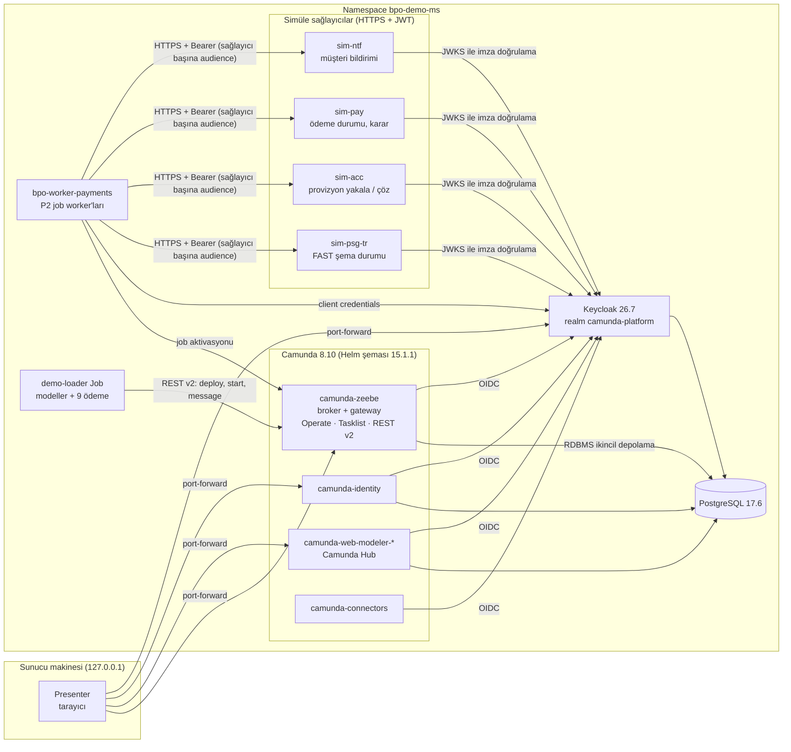
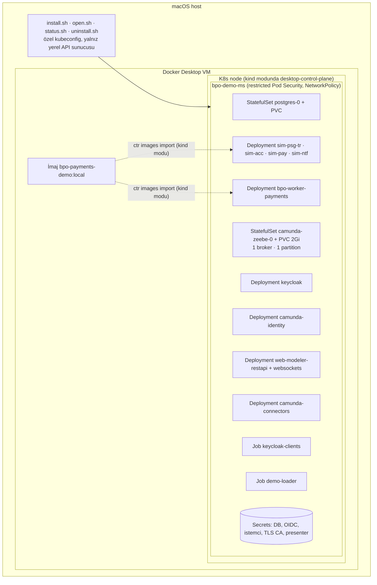
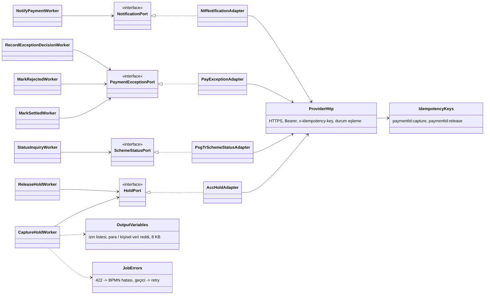
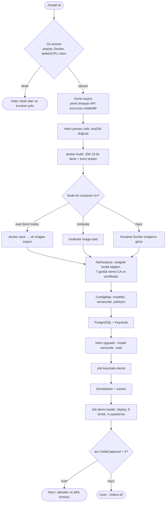
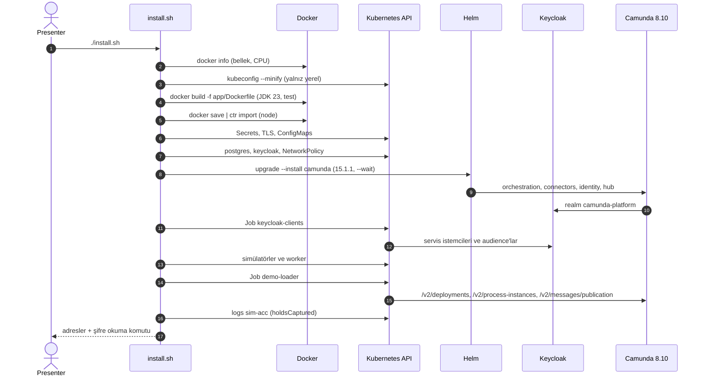
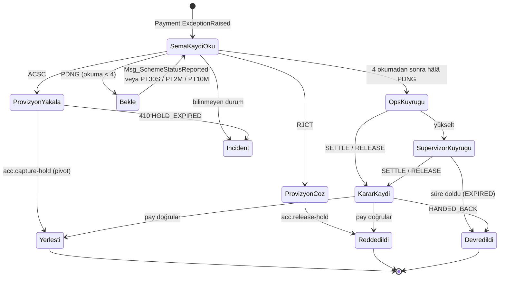
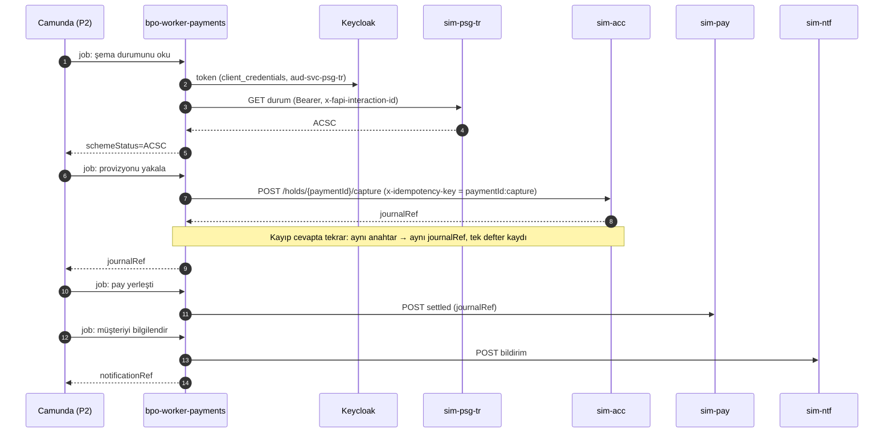

# demo-camunda-k8s

**Camunda 8.10** üzerinde **TR BKM FAST istisna süreci** (P2 `pay-instant-exception`) demosu. Yerel bir
Kubernetes kümesine (varsayılan: Docker Desktop) **tek komutla** kurulur. Her bileşen ayrı bir servis olarak
çalışır: Camunda 8.10 orkestrasyon kümesi, Connectors, Management Identity, Camunda Hub, Keycloak, PostgreSQL,
dört simüle sağlayıcı ve gerçek ödeme worker'ları.

```bash
./install.sh
```

Yerel ve geçici bir demodur; yalnızca **sentetik veri** kullanır. Hedef üretim topolojisi değildir (bkz. [Hedef topolojiden farklar](#hedef-topolojiden-farklar)).

---

## İçindekiler

1. [Hızlı başlangıç](#hızlı-başlangıç)
2. [Ön koşullar](#ön-koşullar)
3. [Mimari (UML)](#mimari-uml)
4. [Kurulum akışı](#kurulum-akışı)
5. [P2 süreci ve örnek veri](#p2-süreci-ve-örnek-veri)
6. [Demo senaryosu](#demo-senaryosu)
7. [Test durumu](#test-durumu)
8. [Güvenlik modeli](#güvenlik-modeli)
9. [Komutlar ve ayarlar](#komutlar-ve-ayarlar)
10. [Sorun giderme](#sorun-giderme)
11. [Depo yapısı](#depo-yapısı)
12. [Hedef topolojiden farklar](#hedef-topolojiden-farklar)

---

## Hızlı başlangıç

```bash
git clone https://github.com/COPUR/demo-camunda-k8s.git
cd demo-camunda-k8s
./install.sh          # ilk kurulum uzun sürer (imajlar, Gradle, Helm şeması iner); süre makineye göre değişir
./open.sh             # ayrı bir terminalde açık bırakın; arayüzler yalnız 127.0.0.1'de
```

Giriş: kullanıcı adı **`presenter`**. Şifre kurulumda rastgele üretilir ve yalnızca bir Kubernetes Secret'ında
durur; `install.sh` sonunda okuma komutunu yazdırır.

| Arayüz | Adres | Ne gösterir |
|---|---|---|
| Operate | http://localhost:8080/operate | Süreç örnekleri, izlenen yol, değişkenler, bekleme durumları, olay kayıtları |
| Tasklist | http://localhost:8080/tasklist | `pay-tr-fast-ops` ve `pay-tr-fast-supervisor` kuyruklarındaki kararlar |
| Hub | http://localhost:8070 | BPMN, DMN ve form modelleri (8.10'da Web Modeler + Console = Hub) |
| Identity | http://localhost:8084 | Kullanıcılar, roller, istemciler |
| Keycloak | http://localhost:18080/auth | OIDC sağlayıcı (yönetici konsolu demo için gerekmez) |

Durum kontrolü: `./status.sh`. Her şeyi silmek için: `./uninstall.sh`.

---

## Ön koşullar

| Gereksinim | Neden | Kontrol |
|---|---|---|
| Docker Desktop, **Kubernetes açık** | Küme ve imaj derlemesi | `kubectl --context docker-desktop get nodes` → `Ready` |
| Docker belleği **≥ 8 GB** (12 GB önerilir), **6 CPU** önerilir | Camunda, Hub, Keycloak, PostgreSQL ve 5 Java servisi | `docker info --format '{{.MemTotal}} {{.NCPU}}'` |
| `kubectl`, `helm` 3.19+ veya 4.x, `openssl`, `curl` | Kurulum betikleri | macOS: `brew install kubectl helm openssl` |
| Boş disk ≈ 10 GB | Camunda imajları ve derleme önbelleği | `docker system df` |
| Windows'ta **WSL 2** (Ubuntu) | Betikler bash; Git Bash yol dönüştürmesi `docker run -v` bağlamalarını bozar | Docker Desktop > Settings > Resources > WSL integration açık; depoyu WSL içinde (`~/`) klonlayın |

**JDK veya Gradle gerekmez:** uygulama imajı Docker içinde JDK 23 ile derlenir ve test edilir; `keytool` da
çalışma zamanı imajının içinde koşar.

Kümede başka iş yükleri belleğin büyük kısmını istiyorsa pod'lar `Pending` kalabilir; `install.sh` bunu uyarı
olarak bildirir.

---

## Mimari (UML)

### Bileşen diyagramı



### Dağıtım diyagramı



### Sınıf diyagramı: worker'ın hexagonal yapısı



---

## Kurulum akışı

`install.sh` tek komuttur ve tekrar çalıştırılabilir: var olan Secret'lar korunur, geri kalan her şey yeniden
uygulanır.



### Kurulum dizisi



---

## P2 süreci ve örnek veri

`pay-instant-exception`, FAST'ten cevabı gelmeyen bir anlık ödemeyi devralır. Süreç talimatı **asla yeniden
göndermez**; yalnızca ağ geçidinin (`psg-tr`) kaydını okur.

### Durum makinesi



### ACSC yolu



### Örnek veri (`sample-data/scenarios.json`)

| Ödemeler | psg-tr cevabı | Sonuç |
|---|---|---|
| `demo-tr-acsc-001..003` | ACSC | provizyon tek kez yakalanır, pay yerleşti, müşteri bilgilenir |
| `demo-tr-rjct-001..002` | RJCT | provizyon çözülür, pay reddedildi, müşteri bilgilenir |
| `demo-tr-pdng-001` | önce PDNG, sonra ACSC | bekler, olay uyandırır, ikinci okuma yerleştirir |
| `demo-tr-unres-001..003` | her okumada PDNG | dört okuma, sonra TR FAST operasyon kuyruğunda görev |

Beklenen: **9 örnek; 4 yerleşti, 2 reddedildi, 3 Tasklist'te karar bekliyor.** Yükleyici
`Msg_SchemeStatusReported` mesajını üç kez yayımlar (olay köprüsünün yapacağı gibi); böylece demo gerçek
zamanlayıcıları beklemez.

**Camunda yalnızca süreç durumunu tutar:** kimlik, enum, zaman damgası. Tutar, IBAN, isim veya iş kuralı sürece
girmez; `OutputVariables` bunları çalışma anında reddeder.

---

## Demo senaryosu

1. **Operate:** `pay-instant-exception`, 9 örnek. Yerleşmiş bir örneği açın: yol `Task_CaptureHold` üzerinden
   geçer, değişkenler yalnızca kimlik ve enum.
2. **Operate, bekleme durumları (8.10):** bekleyen örneklerde sürecin neyi beklediği görünür.
3. **Tasklist:** belirsiz kalan üç ödeme. Birini yerleştirin, birini reddedin, birini süpervizöre yükseltip
   orada kapatın.
4. **Hub:** P2 modeli, `lib-await-external-status` ve iki DMN.
5. **Güvenlik:** `kubectl -n bpo-demo-ms logs deploy/sim-psg-tr` kabul edilen audience'ı ve çağrı sayısını
   gösterir; geçerli token'ı olmayan çağrı 401 veya 403 alır.

---

## Test durumu

| Ortam | Durum |
|---|---|
| k3s (Linux sandbox, `DEMO_CLUSTER=current`, `DEMO_IMAGE_LOAD` ile) | `./install.sh` baştan sona çalıştı; 14 pod çalışıyor, doğrulama 4 bloke tahsilini gördü |
| Docker Desktop, kind modu (macOS) | Temiz klondan `./install.sh` baştan sona çalıştı (çıkış kodu 0); 12 pod çalışıyor, doğrulama 4 bloke tahsilini gördü |
| Docker Desktop kubeadm modu, OrbStack, Rancher Desktop, minikube | Denenmedi |

Süreler yaklaşıktır ve ağa, makineye göre değişir.

---

## Güvenlik modeli

| Konu | Demoda |
|---|---|
| Kimlik bilgileri | `install.sh` içinde `openssl rand` ile üretilir, yalnızca Secret'larda durur, hiçbir çıktıya yazılmaz |
| İnsan girişi | Keycloak OIDC, kullanıcı `presenter` |
| Servis girişi | Client credentials; sağlayıcı başına audience (`aud-svc-psg-tr`, `aud-svc-acc-accounts-ledger`, `aud-svc-pay-initiation-settlement`, `aud-svc-ntf`) |
| Sağlayıcı tarafı | Simülatörler imza, issuer, süre, audience ve çağıranı (azp) doğrular |
| Taşıma | Keycloak ve simülatörler HTTPS (7 günlük demo CA); Camunda ↔ Keycloak/PostgreSQL namespace içinde HTTP |
| Ağ | Varsayılan ret NetworkPolicy ve akış başına izinler. Tarayıcı portları (8080, 8084, 8081, 8060) ile Keycloak (18080, 8443) her kaynaktan, başka namespace'ler dahil, erişilebilir. Docker Desktop NetworkPolicy uygulamaz; orada sınır ClusterIP servisleri ve 127.0.0.1 port-forward'larıdır. |
| Pod'lar | Restricted Pod Security, root değil, tüm capability'ler düşürülmüş |
| Erişim | `open.sh` yalnızca 127.0.0.1'e bağlanır |
| Küme | Betikler yalnızca API sunucusu bu makinede olan kümeye çalışır, kendi kubeconfig kopyasıyla |
| İmajlar | Yerel imaj dışındakiler digest ile sabit; Helm şeması sha256 ile doğrulanır |

---

## Komutlar ve ayarlar

| Komut | Ne yapar |
|---|---|
| `./install.sh` | Kurar veya günceller (tekrar çalıştırılabilir) |
| `./open.sh` | Arayüzleri 127.0.0.1'de yayınlar; Ctrl-C ile kapanır |
| `./status.sh` | Pod'lar, yükleyici sonucu, simülatör sayaçları, worker uyarıları |
| `./uninstall.sh` | Helm sürümünü ve namespace'i siler (veri ve Secret'lar dahil) |

| Ortam değişkeni | Varsayılan | Anlamı |
|---|---|---|
| `DEMO_CLUSTER` | `auto` | `auto`: varsa `docker-desktop`, yoksa geçerli context · `docker-desktop` · `current` |
| `DEMO_IMAGE_LOAD` | otomatik | İmajı kümeye aktaran komut (stdin'den arşiv okur), ör. `"kind load image-archive /dev/stdin"`, `"sudo k3s ctr images import -"` |
| `DEMO_SKIP_TESTS` | `false` | `true`: imajı birim testleri koşmadan derler |
| `DEMO_BUILD_CA` | boş | TLS denetleyen kurumsal proxy arkasında, imaj derlemesinin güveneceği CA dosyası (tek sertifika ya da paket) |

Başka yerel kümeler (kind, k3s, minikube, OrbStack, Rancher Desktop): API sunucusu bu makinedeyse
`DEMO_CLUSTER=current ./install.sh`.

---

## Sorun giderme

| Belirti | Neden | Çözüm |
|---|---|---|
| Simülatör veya worker `ErrImageNeverPull` | Küme Docker'ın imajlarını görmüyor | Kind modu otomatik algılanır; başka kümelerde `DEMO_IMAGE_LOAD` verin |
| Pod'lar `Pending` | Bellek yetersiz | Docker belleğini artırın veya kümedeki diğer iş yüklerini durdurun |
| `helm ... --wait` zaman aşımı | İlk imaj indirmesi yavaş veya bellek yetersiz | `kubectl -n bpo-demo-ms get pods`, sonra `./install.sh` tekrar |
| Derlemede `PKIX path building failed` | Kurumsal proxy TLS'i denetliyor | Proxy CA'sını `DEMO_BUILD_CA=/yol/ca.crt ./install.sh` ile verin |
| `the payments worker has stalled ... restarting it once` | Worker ilk yüklemede bazen job almayı bırakıyor (incident yok, job'lar `CREATED`) | Kendiliğinden düzelir: install.sh worker'ı bir kez yeniden başlatır, açık job'lar devam eder. İkincisinde de 4 bloke yoksa hata verir. |
| Pod'lar `Pending`, olayda `disk-pressure` | Docker'ın diski dolu | `docker system df`; gereksiz imajları temizleyin veya Docker disk sınırını artırın |
| `chart sha256 mismatch` | İndirme bozuk | `.cache/` silip tekrar deneyin |
| Giriş başarısız | Yanlış kullanıcı/şifre | Kullanıcı `presenter`; şifre Secret `demo-presenter` içinde |
| Sertifika hatası (7 gün sonra) | Demo CA süresi doldu | `./install.sh` tekrar: süresi bir günden az kalan CA'yı ve sunucu sertifikalarını yeniler, Keycloak'u yeniden başlatır |
| `$'\r': command not found` | Windows'ta CRLF ile klonlandı | `.gitattributes` LF'yi zorlar; eski klonu silip yeniden klonlayın |

```bash
./status.sh
kubectl -n bpo-demo-ms describe pod <pod>
kubectl -n bpo-demo-ms logs <pod> --tail=50
```

---

## Depo yapısı

```text
install.sh  open.sh  status.sh  uninstall.sh
lib/common.sh          küme seçimi, yerel API koruması, imaj aktarımı
helm/                  values-camunda.yaml, chart-lock.yaml (camunda-platform 15.1.1, sha256)
k8s/                   00 namespace · 10 postgres · 20 keycloak · 30 keycloak istemcileri
                       40 simülatörler + worker · 50 network policy · 60 yükleyici Job
models/                P2 BPMN, L3 kütüphane süreci, 2 DMN, 2 form
sample-data/           scenarios.json (9 sentetik ödeme), load.sh
app/                   Gradle çok modüllü uygulama ve çok aşamalı Dockerfile
  bpo-worker-kit/      idempotency anahtarları, çıktı korkuluğu, sağlayıcı HTTP, hata eşleme
  bpo-worker-payments/ P2 job worker'ları (handler → port → adapter)
  domain-simulator/    sağlayıcı sözleşmelerinin süreç içi taklidi
  payments-demo/       tek imaj: worker'lar veya bir simüle sağlayıcı (rol başına Deployment)
```

---

## Hedef topolojiden farklar

Bunlar bilinçli demo kısayollarıdır.

| Demo | Hedef (TR üretim) |
|---|---|
| 1 broker, 1 partition, replikasyon 1 | 3 broker, 6 partition, replikasyon 3, PDB minAvailable 2 |
| İkincil depolama PostgreSQL (RDBMS) | OpenSearch |
| Worker ve yükleyici admin rolünde | Her istemcinin kendi yetkileri |
| 7 günlük demo CA, Camunda iç trafiği HTTP | Mesh, katı mTLS ve DPoP |
| Sağlayıcılar simülatör | Yayımlanmış katalog sözleşmeleri (`acc`, `pay`, `psg-tr`, `ntf`) |
| Connectors ve Hub açık | Kapalı; her dış çağrı sözleşmesi olan bir worker'dan geçer |

Kaynak: `COPUR/neo-fintechbankx-bpo-process-orchestration` commit `b8c4f50` (`demo/microservices`). Bu
depoda eklenenler: sağlayıcı başına worker kapsamları (`BPO_AUTH_SCOPE_*`), kind modu imaj aktarımı, Docker
içinde derleme (hostta JDK gerekmez), kurulum sonrası doğrulama ve `status.sh`.
