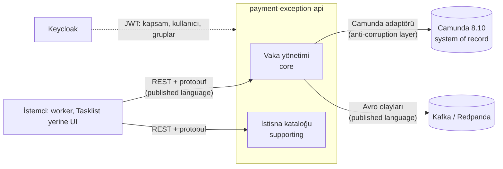
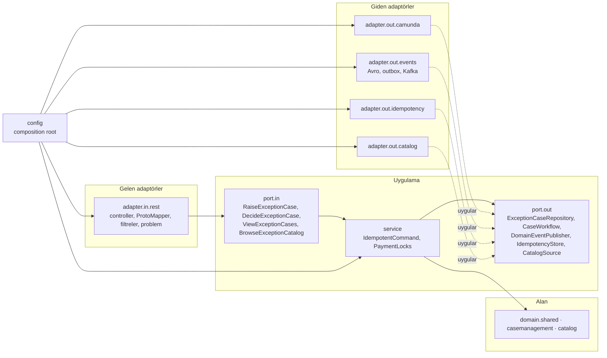

# payment-exception-api

P2 `pay-instant-exception` sürecinin **istisna vakaları** için REST API. Gövdeler **protobuf** (ikili
`application/x-protobuf` ve proto3 JSON eşlemesiyle `application/json`), alan olayları **Avro**. Vakanın kaydı
Camunda'dadır (system of record): API kendi kopyasını tutmaz, süreç örneğini okur ve komutlarını motora iletir.

Yalnızca sentetik veri (`demo-tr-*`). Üretim topolojisi değildir. Varsayılan `./demo.sh up` bu servisi kümeye
kurmaz; imaj derlemesi modülü yalnızca derler ve test eder (bkz. [Bilinen sınırlar](#bilinen-sınırlar)).

## İçindekiler

1. [Alt alanlar ve bağlam haritası](#alt-alanlar-ve-bağlam-haritası)
2. [Hexagonal yapı](#hexagonal-yapı)
3. [Uç noktalar](#uç-noktalar)
4. [Value object, protobuf ve Avro eşlemesi](#value-object-protobuf-ve-avro-eşlemesi)
5. [İstisna durumu kataloğu](#istisna-durumu-kataloğu)
6. [Hata kodu deposu](#hata-kodu-deposu)
7. [Güvenlik](#güvenlik)
8. [AWS Well-Architected sütunları](#aws-well-architected-sütunları)
9. [Dağıtık sistem kararları](#dağıtık-sistem-kararları)
10. [Test ve kapsam](#test-ve-kapsam)
11. [Yapılandırma](#yapılandırma)
12. [Bilinen sınırlar](#bilinen-sınırlar)

---

## Alt alanlar ve bağlam haritası

| Alt alan | Tür | Paket | İçerik |
|---|---|---|---|
| Paylaşılan çekirdek | — | `domain.shared` | `PaymentId`, `Jurisdiction`, `Rail`, `Actor`, `InteractionId`, `EventId`, `ErrorCode`, `DomainException` |
| Vaka yönetimi | Çekirdek (core) | `domain.casemanagement` | `ExceptionCase` kümesi, `ReviewTask`, `Reviewer`, `Decision`, `ReviewLevel`, `JurisdictionPolicy`, alan olayları |
| İstisna kataloğu | Destekleyici (supporting) | `domain.catalog` | `ExceptionCatalog`, `ExceptionCaseDefinition`, `ErrorDefinition` |

İki alt alan birbirini tanımaz (ArchUnit kuralı). Dış bağlamlarla ilişki:



Camunda'nın kavramları (süreç örneği, kullanıcı görevi, değişken) yalnızca `adapter.out.camunda` içinde kalır;
alan modeli `ExceptionCase`, `ReviewTask`, `CaseState` ile konuşur.

## Hexagonal yapı



Bağımlılıklar içe doğrudur ve `ArchitectureTest` bunu her derlemede denetler: alan yalnızca `java.*` kullanır;
uygulama yalnızca alanı ve kendi portlarını bilir; protobuf sözleşmesi yalnızca REST adaptöründe, Avro ve Kafka
yalnızca olay adaptöründe, Camunda istemcisi yalnızca Camunda adaptöründe; adaptörler birbirine bağımlı değildir;
paketlerde döngü yoktur.

## Uç noktalar

Taban yol `/api/v1`. Her istek `Authorization: Bearer <JWT>` taşır; `x-fapi-interaction-id` (UUID) gönderilirse
aynısı döner, yoksa üretilir.

| Yöntem ve yol | Kapsam | Başlıklar | Başarı |
|---|---|---|---|
| `POST /payment-exceptions` | `exceptions:raise` | `Idempotency-Key` (zorunlu) | `201`, `Location`, `ETag`, `Idempotent-Replayed` |
| `GET /payment-exceptions/{paymentId}` | `exceptions:read` | `If-None-Match` (isteğe bağlı) | `200` + `ETag`, ya da `304` |
| `GET /payment-exceptions?queue=&reviewLevel=&pageSize=&pageToken=` | `exceptions:read` | — | `200`, `nextPageToken` |
| `POST /payment-exceptions/{paymentId}/decisions` | `exceptions:decide` | `If-Match` ve `Idempotency-Key` (zorunlu) | `202`, `Location`, `Idempotent-Replayed` |
| `GET /exception-catalog` | `exceptions:read` | `If-None-Match` | `200` + `ETag: "catalog-<sürüm>"`, `Cache-Control: private, max-age=300` |
| `GET /exception-catalog/cases/{code}` | `exceptions:read` | — | `200` |
| `GET /exception-catalog/errors/{code}` | `exceptions:read` | — | `200` |
| `GET /actuator/health/liveness`, `/readiness` (yönetim portu) | — | — | `200` |

Vakanın `ETag`'i açık inceleme görevidir (`"rt-<userTaskKey>"`), görev yoksa durumudur. Karar, okunan görünümü
`If-Match` ile adlandırır: görev değiştiyse `412 PEX-3004`, başlık yoksa ya da `*` ise `428 PEX-3005`. Zayıf
(`W/`) etiket eşleşmez. Kararı yalnızca görevin kuyruğundaki kişi verir (`403 PEX-2003`), başkasının üstlendiği
görev `409 PEX-3008` döner.

Her hata RFC 9457 `application/problem+json`'dır ve `type` alanı hata kodu deposundaki kaydı gösterir:

```json
{"type":"/api/v1/exception-catalog/errors/PEX-3004","title":"Review task changed since it was read",
 "status":412,"detail":"...","instance":"/api/v1/payment-exceptions/demo-tr-unres-001/decisions",
 "code":"PEX-3004","error":"REVIEW_TASK_CHANGED","retryable":false,"interactionId":"7f9c1d6e-..."}
```

Sözleşme dosyaları `src/main/proto/bpo/exceptions/v1/` altındadır: `value_objects.proto`,
`payment_exception.proto`, `exception_catalog.proto`. JSON ayrıştırıcı sözleşmede olmayan alanı reddeder; ikili
mesajdaki bilinmeyen alan da reddedilir (`400 PEX-1008`).

## Value object, protobuf ve Avro eşlemesi

| Value object | Kural | Protobuf | Avro (`PaymentExceptionEvent`) |
|---|---|---|---|
| `PaymentId` | `demo-tr-[a-z0-9][a-z0-9-]{0,39}` | `string payment_id` | `paymentId: string` (kayıt anahtarı) |
| `Jurisdiction` | ISO 3166-1 alfa-2 | `string jurisdiction` | `ExceptionCaseRaised.jurisdiction: string` |
| `Rail` | yalnız `FAST` | `enum Rail { RAIL_UNSPECIFIED, RAIL_FAST }` | `enum Rail { UNKNOWN, FAST }`, varsayılan `UNKNOWN` |
| `CaseState` | 7 durum, 4'ü son durum | `enum CaseState` | — (olaylar durumu değil, olguyu taşır) |
| `ReviewTaskId` | > 0 | `int64 task_id` (JSON'da string) | `reviewTaskId: long` |
| `ReviewLevel` | OPERATIONS, SUPERVISOR | `enum ReviewLevel` | `enum ReviewLevel { UNKNOWN, OPERATIONS, SUPERVISOR }` |
| `QueueName` | `[a-z0-9][a-z0-9-]{1,62}` | `string queue` | `queue: ["null","string"]` |
| `Decision` | kişinin kararı SETTLED, REJECTED, ESCALATE; EXPIRED süreçten | `enum Decision` | `enum Decision { UNKNOWN, ... }` |
| `Actor` | boş değil, ≤ 255, denetim karakteri yok | — (token'dan okunur) | `actor: Actor { subject }` |
| `InteractionId` | küçük harf UUID | başlık `x-fapi-interaction-id` | `interactionId: string (uuid)` |
| `EventId` | olgudan türetilmiş isim tabanlı UUID | — | `eventId: string (uuid)` |
| `Instant` | UTC | `google.protobuf.Timestamp` | `long (timestamp-millis)` |

Protobuf enum'larının sıfır değeri her zaman `*_UNSPECIFIED`'dır ve alana girmez (eşleyici reddeder). Avro
enum'larının `UNKNOWN` varsayılanı, eski bir okuyucunun yeni bir sembolü okuyabilmesi içindir. Avro şeması
`src/main/resources/avro/payment-exception-event.avsc`; yayımlanan sürümün kopyası
`src/test/resources/avro/baseline/` altında ve şema iki yönde de uyumlu kalmak zorunda (`AvroEventCodecTest`).
Mesajlar Avro single-object encoding ile yazılır (`C3 01`, şemanın 64 bitlik parmak izi, kayıt); Kafka
başlıkları `event-type`, `event-id`, `content-type`, `x-fapi-interaction-id`.

## İstisna durumu kataloğu

Kaynak: `src/main/resources/catalog/exception-catalog.yaml` (sürüm 1.0.0), API'de `GET /api/v1/exception-catalog`.
Her kayıt tetikleyiciyi, BPMN öğelerini, yönlendirmeyi, SLA kaynağını, sahibi ve runbook'u taşır.
`CatalogConsistencyTest`, kaydın andığı her BPMN öğesinin `models/` altındaki modellerde gerçekten olduğunu,
alanın verdiği her nedenin (`ExceptionReason`) katalogda bulunduğunu denetler.

| Kod | Ad | Alt alan | Yönlendirme | İzinli kararlar | İlgili hatalar |
|---|---|---|---|---|---|
| `EXC-001` | `SCHEME_STATUS_TIMEOUT` | scheme-status | OPERATIONS | SETTLED, REJECTED, ESCALATE | `PEX-2003`, `PEX-3003`, `PEX-3004`, `PEX-3008`, `PEX-4001` |
| `EXC-002` | `SCHEME_STATUS_UNCLEAR` | scheme-status | OPERATIONS | SETTLED, REJECTED, ESCALATE | `PEX-2003`, `PEX-3004`, `PEX-3008`, `PEX-4001` |
| `EXC-003` | `OPERATIONS_ESCALATION` | case-management | SUPERVISOR | SETTLED, REJECTED | `PEX-2003`, `PEX-3004`, `PEX-4001` |
| `EXC-004` | `OPERATIONS_SLA_EXPIRED` | case-management | SUPERVISOR | SETTLED, REJECTED | `PEX-3004` |
| `EXC-005` | `SUPERVISOR_SLA_EXPIRED` | case-management | PAY | — | `PEX-3003`, `PEX-4001` |
| `EXC-006` | `HANDED_BACK_TO_PAY` | payments | PAY | — | `PEX-3003` |
| `EXC-007` | `PROVIDER_BUSINESS_REJECTION` | workflow | ENGINEERING | — | — |
| `EXC-008` | `PROVIDER_TRANSIENT_FAILURE` | workflow | ENGINEERING | — | — |
| `EXC-009` | `PROVIDER_CONTRACT_FAULT` | workflow | ENGINEERING | — | — |
| `EXC-010` | `PROVIDER_IDEMPOTENCY_KEY_REUSED` | workflow | ENGINEERING | — | — |

`EXC-001`–`EXC-006` vakanın yaşam döngüsüdür; `EXC-007`–`EXC-010` worker'ın sağlayıcı hatalarıdır
(`bpo-worker-kit` hata eşlemesi) ve olay (incident) olarak mühendisliğe gider.

## Hata kodu deposu

Aynı YAML dosyasının `errors` bölümü; API'de `GET /api/v1/exception-catalog/errors/{code}`. Her kayıt açıklama ve
çözüm (remediation) içerir. Kod tarafı `ErrorCode` enum'ıdır; `CatalogConsistencyTest`, her kodun adının,
başlığının, kategorisinin, tekrar bayrağının ve HTTP durumunun katalogla aynı olduğunu, katalogda fazladan kod
olmadığını denetler.

| Kod | Ad | HTTP | Kategori | Tekrar denenir |
|---|---|---|---|---|
| `PEX-1001` | `INVALID_PAYMENT_ID` | 400 | VALIDATION | hayır |
| `PEX-1002` | `INVALID_JURISDICTION` | 400 | VALIDATION | hayır |
| `PEX-1003` | `UNSUPPORTED_RAIL` | 400 | VALIDATION | hayır |
| `PEX-1004` | `INVALID_DECISION` | 400 | VALIDATION | hayır |
| `PEX-1005` | `INVALID_IDEMPOTENCY_KEY` | 400 | VALIDATION | hayır |
| `PEX-1006` | `IDEMPOTENCY_KEY_REQUIRED` | 400 | VALIDATION | hayır |
| `PEX-1007` | `INVALID_PAGE_REQUEST` | 400 | VALIDATION | hayır |
| `PEX-1008` | `MALFORMED_REQUEST` | 400 | VALIDATION | hayır |
| `PEX-1009` | `INVALID_QUEUE` | 400 | VALIDATION | hayır |
| `PEX-2001` | `UNAUTHENTICATED` | 401 | AUTHENTICATION | hayır |
| `PEX-2002` | `FORBIDDEN` | 403 | AUTHORIZATION | hayır |
| `PEX-2003` | `NOT_A_QUEUE_MEMBER` | 403 | AUTHORIZATION | hayır |
| `PEX-3001` | `EXCEPTION_CASE_NOT_FOUND` | 404 | NOT_FOUND | hayır |
| `PEX-3002` | `EXCEPTION_CASE_ALREADY_EXISTS` | 409 | CONFLICT | hayır |
| `PEX-3003` | `NO_OPEN_REVIEW` | 409 | CONFLICT | hayır |
| `PEX-3004` | `REVIEW_TASK_CHANGED` | 412 | PRECONDITION | hayır |
| `PEX-3005` | `PRECONDITION_REQUIRED` | 428 | PRECONDITION | hayır |
| `PEX-3006` | `IDEMPOTENCY_KEY_REUSED` | 422 | CONFLICT | hayır |
| `PEX-3007` | `IDEMPOTENT_REQUEST_IN_PROGRESS` | 409 | CONFLICT | evet |
| `PEX-3008` | `REVIEW_TASK_CLAIMED_BY_OTHER` | 409 | CONFLICT | hayır |
| `PEX-3009` | `CATALOG_ENTRY_NOT_FOUND` | 404 | NOT_FOUND | hayır |
| `PEX-4001` | `DECISION_NOT_ALLOWED` | 422 | BUSINESS_RULE | hayır |
| `PEX-4002` | `JURISDICTION_NOT_SERVED` | 422 | BUSINESS_RULE | hayır |
| `PEX-5001` | `PAYLOAD_TOO_LARGE` | 413 | LIMIT | hayır |
| `PEX-5002` | `UNSUPPORTED_MEDIA_TYPE` | 415 | VALIDATION | hayır |
| `PEX-5003` | `NOT_ACCEPTABLE` | 406 | VALIDATION | hayır |
| `PEX-5004` | `RATE_LIMITED` | 429 | LIMIT | evet |
| `PEX-5005` | `METHOD_NOT_ALLOWED` | 405 | VALIDATION | hayır |
| `PEX-5006` | `RESOURCE_NOT_FOUND` | 404 | NOT_FOUND | hayır |
| `PEX-9001` | `WORKFLOW_UNAVAILABLE` | 503 | DEPENDENCY | evet |
| `PEX-9002` | `WORKFLOW_REJECTED` | 502 | DEPENDENCY | hayır |
| `PEX-9999` | `INTERNAL_ERROR` | 500 | INTERNAL | hayır |

Tekrar denenebilir yanıtlar `Retry-After` taşır (`PEX-3007` 1 sn, `PEX-5004` kovanın dolma süresi, `PEX-9001` 5 sn).

## Güvenlik

| Konu (OWASP API Top 10 2023) | Önlem |
|---|---|
| API1 nesne düzeyinde yetki | Kararı yalnızca görevin kuyruğunun üyesi verir (token'daki `groups`); başkasının üstlendiği görev reddedilir |
| API2 kimlik doğrulama | OAuth2 resource server; RS256, issuer, audience (`payment-exception-api`) ve 30 sn saat kayması denetimi; JWKS çağrısı 2 sn bağlantı, 3 sn okuma zaman aşımıyla |
| API3 nesne özelliği düzeyinde yetki | Katı protobuf ayrıştırma: sözleşmede olmayan alan reddedilir; yanıt yalnızca sözleşmedeki alanları taşır |
| API4 kaynak tüketimi | Gövde sınırı 16 KiB (beyan edilen ve parça parça gelen gövdede), çağıran başına token kovası (429 + `Retry-After`), sınırlı idempotency ve okuma önbellekleri, sayfa boyutu ≤ 100 |
| API5 işlev düzeyinde yetki | İşlem başına kapsam: `exceptions:read`, `exceptions:raise`, `exceptions:decide`; listede olmayan her istek reddedilir |
| API8 yanlış yapılandırma | Durumsuz, çerez yok, CSRF yüzeyi yok; `Cache-Control: no-store`, CSP `default-src 'none'`, `Referrer-Policy: no-referrer`, `X-Frame-Options: DENY`; hata ayrıntısı ve yığın izi dışarı çıkmaz; actuator yalnızca health ve info |
| API10 güvensiz tüketim | Motorun yanıtı alan modeline doğrulanarak çevrilir; okunamayan örnek `502 PEX-9002` olur |
| Veri yerleşimi | `JurisdictionPolicy`: servis yalnızca hizmet verdiği yetki alanının vakasını açar (`422 PEX-4002`) |
| Sentetik veri | `BPO_DEMO_ACK=synthetic-data-only` yoksa servis başlamaz; ödeme kimliği `demo-tr-*` dışındaysa reddedilir |
| Gizli bilgi | Depoda ve imajda gizli bilgi yok; issuer, JWKS ve motor kimlik bilgileri ortamdan gelir |

401 ve 403 yanıtları RFC 6750 `WWW-Authenticate: Bearer` başlığını taşır.

## AWS Well-Architected sütunları

| Sütun | Bu modülde |
|---|---|
| Operasyonel mükemmellik | Ortamdan yapılandırma (12 faktör III), ayrı yönetim portu ve probe'lar, korelasyon kimliği log'da ve olayda, katalogdaki runbook alanları |
| Güvenlik | Yukarıdaki tablo; en az yetki kapsamları, derinlemesine savunma (filtre → kimlik → kapsam → nesne kuralı) |
| Güvenilirlik | Idempotency anahtarı, If-Match ile iyimser eşzamanlılık, motor çağrısında zaman aşımı, tekrar denenebilir hata için 503 + `Retry-After`, outbox'ta üstel geri çekilme ve jitter, hazırlık probe'u bağımlılığa bağlı değil (motor yavaşsa tüm kopyalar birden servis dışı kalmaz) |
| Performans verimliliği | İkili protobuf seçeneği, imleçli sayfalama, sayfa başına üç arama çağrısı (görev, örnek, değişken), koşullu GET (`304`) |
| Maliyet optimizasyonu | Kendi veritabanı yok (motor kayıttır), broker isteğe bağlı, tek imaj |
| Sürdürülebilirlik | Önbelleklenebilir katalog, gereksiz yoklama yok, sınırlı bellek yapıları |

## Dağıtık sistem kararları

- **Tek kayıt sistemi.** Vaka Camunda'dadır; API'nin veritabanı yoktur, ikili yazım (dual write) yoktur.
- **Okuma gecikmesi.** Camunda arama API'si motoru kısa bir gecikmeyle izler. Bu kopyanın açtığı vakalar iki
  dakika boyunca hatırlanır (read-your-writes); başka bir kopyadan okuyan istemci bu sürede tekrar dener.
- **Idempotency.** Anahtar (işlem, çağıran) kapsamındadır; aynı anahtar ve aynı istek ilk yanıtı döner
  (`Idempotent-Replayed: true`), farklı istek `422 PEX-3006` alır, süren istek `409 PEX-3007`.
- **Eşzamanlılık.** Aynı ödeme için kopya içinde kilit; kopyalar arası çit, ödeme kimliğinin süreç örneğinin
  `businessId`'si olmasıdır (motor tekilliği zorlarsa ikinci örnek `409` alır ve `PEX-3002` olur).
- **Tekrar deneme tek katmanda.** API kendi tekrarını yapmaz; Camunda istemcisinin HTTP katmanı 429 ve 503'ü bir
  kez 1 sn sonra yeniden gönderir, sonrası çağıranın işidir (`Retry-After`).
- **Olaylar en az bir kez.** Outbox kuyruğa alır, tek iş parçacığı sırayla teslim eder; kayıt anahtarı ödeme
  kimliğidir (bölüm içinde sıra), olay kimliği olgudan türetilir (tüketici tekrarı ayıklar). Üretici `acks=all`,
  idempotent, uçuşta en fazla 5 istek.

## Test ve kapsam

```bash
cd app && ./gradlew :payment-exception-api:check     # testler + JaCoCo kuralı (satır ve dal ≥ %87)
```

Son çalıştırma: 270 test, hepsi geçti; satır kapsamı %97,8, dal kapsamı %92,3 (üretilen protobuf kodu ve
`main` sınıfı hariç). İmaj derlemesi (`app/Dockerfile`) testlerle birlikte bu kuralı da çalıştırır.

| Katman | Testler |
|---|---|
| Alan | Value object kuralları, `ExceptionCase` değişmezleri ve karar kuralları |
| Uygulama | Use case'ler sahte portlarla; 8 iş parçacığıyla eşzamanlı açma |
| REST | `@SpringBootTest` + MockMvc: JSON ve ikili protobuf, kapsamlar, If-Match, idempotency, problem+json, boyut, medya türleri, probe'lar |
| Camunda | Gerçek `CamundaClient`, loopback'te betikli sahte motor: istek gövdeleri, durum eşleme, sayfalama, hata eşleme, zaman aşımı |
| Olaylar | Avro gidiş-dönüş, single-object başlığı, şema uyumluluğu, `MockProducer`, outbox geri çekilmesi ve kapanış |
| Uygunluk işlevleri | `ArchitectureTest` (hexagonal kurallar), `CatalogConsistencyTest` (kod ↔ katalog ↔ BPMN) |

## Yapılandırma

| Ortam değişkeni | Varsayılan | Anlam |
|---|---|---|
| `BPO_DEMO_ACK` | — (zorunlu) | `synthetic-data-only` |
| `BPO_EXCEPTIONS_SECURITY_ISSUER` | — (zorunlu) | Keycloak realm issuer'ı |
| `BPO_EXCEPTIONS_SECURITY_JWK_SET_URI` | — (zorunlu) | Realm'in JWKS adresi |
| `BPO_EXCEPTIONS_SECURITY_AUDIENCE` | `payment-exception-api` | Token'ın `aud` değeri |
| `BPO_EXCEPTIONS_SECURITY_SSL_BUNDLE` | boş | JWKS için güvenilecek Spring SSL bundle'ı |
| `BPO_EXCEPTIONS_SERVED_JURISDICTIONS` | `TR` | Hizmet verilen yetki alanları |
| `BPO_EXCEPTIONS_EVENTS_KAFKA_BOOTSTRAP_SERVERS` | boş | Doluysa olaylar Kafka/Redpanda'ya, boşsa log'a |
| `BPO_EXCEPTIONS_EVENTS_TOPIC` | `bpo.payment-exception.events.v1` | Konu |
| `CAMUNDA_CLIENT_REST_ADDRESS`, `CAMUNDA_CLIENT_AUTH_*` | — | Motor adresi ve kimliği (Camunda starter) |
| `PORT`, `MANAGEMENT_PORT` | `8080`, `8081` | API ve yönetim portları |

Ayrıntılar `config/ExceptionApiProperties` içindedir; geçersiz değerle servis başlamaz ve özelliği adıyla söyler.

## Bilinen sınırlar

- **Gerçek motora karşı denenmedi.** Camunda adaptörü gerçek istemciyle, 8.10 REST biçimini taklit eden bir sahte
  sunucuya karşı test edildi. Şunlar çalışan bir kümede doğrulanmalı: değişken filtresinin JSON değer biçimi,
  `businessId` tekilliğinin motorda açık olup olmadığı, API'nin servis hesabının kullanıcı görevini tamamlama yetkisi.
- **Belirsiz zaman aşımı.** Motor açma isteğini alıp yanıtı yetiştiremezse, aynı anahtarla tekrar ikinci bir
  örnek açabilir; motorda `businessId` tekilliği bunu kapatır.
- **Bellekte durum.** Idempotency kayıtları, okuma önbelleği, hız sınırı ve outbox kopya başınadır ve yeniden
  başlatmada kaybolur. Outbox kalıcı değildir: süreç ölürse kuyruktaki olaylar gider (kayıt motorda kalır).
  Kalıcı bir outbox (tablo ya da motorun exporter'ı) sonraki adımdır.
- **Kararı veren kişi.** Görev API'nin servis hesabıyla tamamlanır; kararı kimin verdiği olayda (`actor`) ve
  log'dadır. Görevi tamamlamadan önce kişiye atamak sonraki adımdır.
- **Küme kurulumu yok.** Kubernetes manifesti eklenmedi: Keycloak'ta bu API için istemci, audience eşleyicisi ve
  üç kapsam, Camunda'da servis hesabı yetkisi ve NetworkPolicy gerekir; bunlar varsayılan kurulumu değiştirir.
